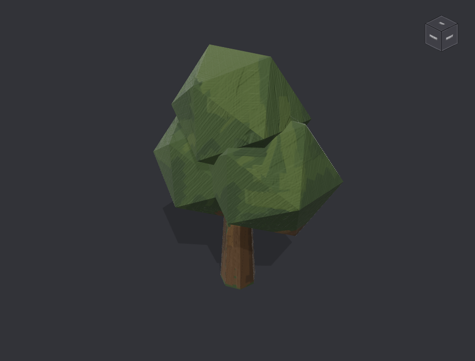
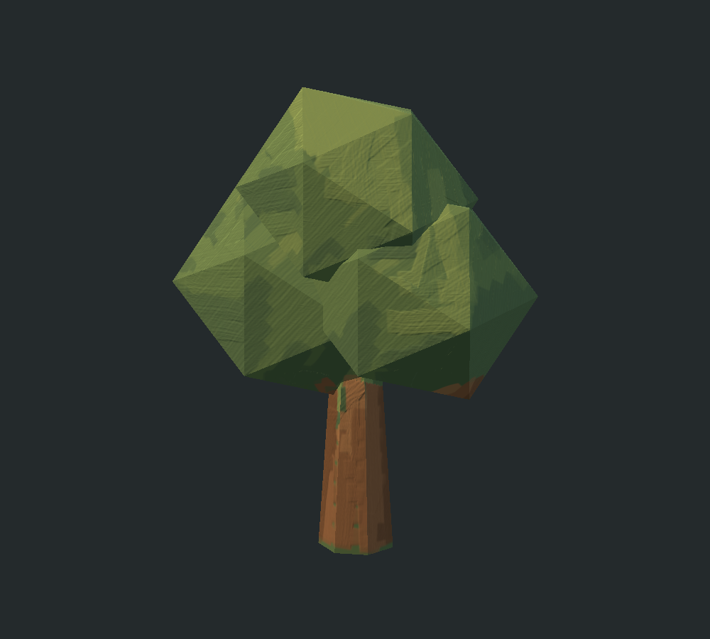

# Prototype validation

Validated on Windows with a GTX 1660 Ti. Other operating systems and graphics backends
have not been exercised. This is a functional prototype, not a claim that every asset
or UV topology is production-ready.

## Executed checks

- TypeScript checks and production build passed; 65 existing unit tests passed.
- The official MCP SDK client completed stdio handshakes and exercised all 16 tools against
  both the compiled Electron app and an unpacked Windows executable.
- GLB import, real surface raycasts, batched probes, strokes, erasing path, brush controls,
  layer creation, undo/redo and lossless project save/reload were exercised.
- MCP returns fresh lit/channel images and actual GPU measurements. Invalid commands,
  browser-Origin/unauthenticated requests, dirty-project replacement and unintended
  overwrites were rejected. Normal launches expose no MCP bridge; endpoints are removed
  when the window closes.
- Height export is PNG16. The height regression found 580 distinct values on one strong
  stroke and 884 on overlapping layers. Changing height left albedo identical; undo/redo,
  reload and layer merge preserved height. Opacity quantization error stayed within half
  a 16-bit code; erasing removed height. The native GUI export matched the direct export.
- The rotated UV seam fixture measured mean neighboring height difference 0.000217 model
  units and mean normal angle 3.99 degrees at 2048. This is finite-resolution behavior,
  not an arbitrary-UV continuity guarantee.
- OpenGL normal Y orientation was compared with the retained field's analytic UV/world
  finite difference on the panel; Godot imports use no green-channel inversion.
- Godot 4.4.1 imported and rendered a one-piece painted tree and a two-piece GLB with
  distinct material assignments. Normal-on/off renders differed. Generated resource
  paths remain relative so the exported folder can move within a Godot project.
- See [performance measurements](PERFORMANCE.md) for the removal of redundant normal work.

The scripted multi-view visual pilot used 484 strokes on a synthetic low-poly tree.
It illustrates controllable directional surface detail and export, not finished artwork.
Some areas remain flat or have uneven color coverage; numeric height coverage is not
an artistic completeness score. All included geometry is procedurally generated.





## Reproduce

```sh
npm ci --legacy-peer-deps
npm run build
npm test
npm run test:mcp
node tools/height-qa.cjs
python tools/verify_height.py
node tools/mcp-paint-demo.mjs
node tools/benchmark-impasto.mjs
```

For a bundle created by the MCP test or visual pilot, use a dedicated test directory:

```sh
python tools/verify_godot_bundle.py --directory work/EXAMPLE/godot --scene assets/painted_tree.tscn --godot /path/to/godot --render
```

The helper refuses to modify an unrelated existing Godot project. The graphics-backed
`--render` mode was tested. Godot 4.4.1's dummy headless importer produced a null-texture
error in one run; it is not reported as a passing headless render.

## Remaining limits

No geometric displacement, oil simulation or legacy-normal-to-height reconstruction.
Tablet hardware, mirrored/smooth UVs, arbitrary PNG16 import, resolution changes, complex
mask combinations, huge projects and all export permutations require further testing.
The portable Godot bundle currently requires GLB; GLTF/OBJ can use per-piece texture export.
Generated materials match imported mesh names and explicitly report unmatched pieces.
MCP is a trusted local opt-in prototype and is not a remote multi-user service.
